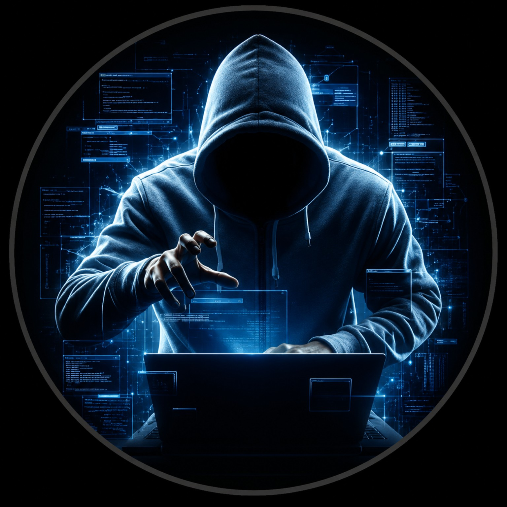

# EEL CIBERSEGURIDAD

> **[Abrir la guía interactiva con enlaces que se abren en pestañas nuevas](https://eelciberseguridad.github.io/eelciberseguridad-ar/guia_realidad_aumentada.html)**
>
> La guía conserva el contenido de este README. Allí, al abrir documentación, demostraciones o fuentes, la guía permanece abierta. **Dentro del README que muestra GitHub no es posible forzar automáticamente una pestaña nueva**; si querés conservarlo abierto, usá `Ctrl + clic` (Windows/Linux), `Cmd + clic` (Mac) o el menú contextual «Abrir enlace en pestaña nueva».

### Realidad aumentada aplicada a la educación y la seguridad digital

**¿Te imaginás que una imagen impresa pudiera convertirse en una escena tridimensional?**

Este proyecto es un laboratorio educativo de realidad aumentada (AR). Al enfocar el logo de **EEL CIBERSEGURIDAD** desde la experiencia web, el sistema reconoce la imagen y superpone sobre ella un personaje digital con volumen, iluminación y efectos animados.

El logo físico no cambia: lo que cambia es lo que vemos a través de la cámara mientras se ejecuta el programa.

## Probalo vos mismo

**1. En la computadora o en una hoja impresa:** mostrá el [logo original](https://eelciberseguridad.github.io/eelciberseguridad-ar/assets/logo-marker.png) completo y de buen tamaño.

**2. En el celular:** abrí con Chrome la [experiencia WebAR V5](https://eelciberseguridad.github.io/eelciberseguridad-ar/eel-3d-v5.html), siempre que esa versión ya esté publicada en GitHub Pages.

**3. Autorizá la cámara:** el navegador necesita permiso para capturar imágenes en tiempo real.

**4. Enfocá el logo:** mantenelo completo en pantalla y mové el teléfono lentamente. Cuando la aplicación lo identifica, aparece la escena digital asociada.

No basta con abrir la aplicación Cámara del teléfono: hace falta ejecutar la página WebAR, porque allí están las instrucciones y los recursos necesarios para reconocer el marcador y mostrar los efectos.

## ¿Qué es la realidad aumentada?

La **realidad aumentada** combina imágenes captadas del mundo físico con información u objetos digitales. A diferencia de la realidad virtual, no reemplaza todo el entorno: agrega una capa de contenido calculada por el software sobre lo que la cámara está mostrando.

En nuestro caso, el objeto real es el logo. El contenido digital incluye un modelo 3D de alto relieve del hacker, iluminación azul y animaciones que parecen estar vinculadas a esa imagen.

## ¿Cómo funciona? Paso a paso

### 1. Elegimos la imagen que servirá de marcador

Primero seleccionamos `assets/logo-marker.png`. El marcador debe tener detalles visuales reconocibles para que el software pueda encontrarlo en diferentes posiciones y ángulos. Puede mostrarse en una pantalla o imprimirse sobre una superficie plana.

### 2. Compilamos sus características visuales

Con el [compilador de imágenes de MindAR](https://hiukim.github.io/mind-ar-js-doc/tools/compile/) procesamos el logo para generar `assets/target.mind`.

Ese archivo contiene información preparada para el reconocimiento: **no es la animación ni una copia de video**. Es la referencia que el motor utiliza para buscar coincidencias con la imagen que ve la cámara.

### 3. El navegador obtiene los fotogramas

Cuando abrimos la experiencia por HTTPS y permitimos el uso de la cámara, el navegador obtiene una secuencia de imágenes en tiempo real. Esta función requiere el consentimiento del usuario.

### 4. MindAR reconoce y sigue el marcador

El motor compara características visuales de los fotogramas con la información del archivo `.mind`. Si encuentra una coincidencia suficientemente confiable, estima la ubicación y la orientación del marcador respecto de la cámara.

No alcanza con identificar **qué** imagen es. También debe saber **dónde está** y **cómo está inclinada**.

### 5. La escena 3D se coloca sobre el logo

**A-Frame**, una herramienta para crear escenas tridimensionales en la web, representa el contenido digital. El navegador utiliza tecnologías gráficas como **WebGL** para dibujar geometría, materiales, luces y animaciones.

En esta versión se utiliza un archivo `.glb`: un modelo con geometría tridimensional de alto relieve. No es todavía una escultura humana completa observable desde cualquier ángulo.

### 6. Todo se actualiza mientras movemos el teléfono

Mientras la cámara continúa viendo el logo, MindAR actualiza su posición estimada y la escena se ajusta. Así aparece la sensación de que los objetos digitales permanecen ligados a la superficie física.

El seguimiento puede temblar o perderse por reflejos, iluminación insuficiente, movimientos bruscos o poca definición. El suavizado reduce saltos, aunque puede introducir un pequeño retraso.

## ¿Qué tiene que ver con la ciberseguridad?

Imaginemos un laboratorio educativo con un esquema impreso de una red: al enfocarlo podrían visualizarse las conexiones entre equipos, el recorrido de paquetes y una representación del trabajo de un firewall. La realidad aumentada permite explorar procesos que normalmente se explican con diagramas estáticos.

Pero también plantea desafíos de seguridad. **Una interfaz digital puede mostrar información que no existe físicamente.**

Pensemos en un comercio que ofrece un catálogo interactivo de productos mediante realidad aumentada. Si un atacante consiguiera sustituir esa experiencia por otra fraudulenta, podría conservar la apariencia del comercio y mostrar instrucciones de pago con un destinatario diferente. El cliente podría confiar en una información falsa superpuesta sobre un entorno auténtico.

Eso **no modifica automáticamente una transferencia bancaria** y no implica que la cámara común del teléfono esté comprometida. Se trata de un escenario hipotético de **ingeniería social mediante una experiencia digital manipulada**, no de un delito específico que estemos afirmando que ya ocurrió.

La enseñanza es importante: **que una imagen física sea legítima no garantiza que la información digital superpuesta también lo sea**.

## ¿Y si imprimo el logo?

La impresión puede funcionar con el mismo `target.mind`, siempre que represente fielmente la imagen original. Recomendamos probar un tamaño de 15 × 15 cm o mayor, buena definición, papel mate y una superficie plana. La calidad del seguimiento depende de las condiciones reales de la prueba.

## Tecnología y archivos principales

- **MindAR:** reconocimiento y seguimiento de la imagen.
- **A-Frame / WebGL:** representación de la escena 3D.
- **GLB:** geometría y materiales del modelo digital.
- **GitHub Pages:** publicación de los archivos estáticos mediante HTTPS.
- **`assets/logo-marker.png`:** imagen original que se enfoca.
- **`assets/target.mind`:** marcador compilado para MindAR.
- **`eel-3d-v5.html`:** experiencia experimental de realidad aumentada, si fue publicada.

## Seguridad y privacidad

Esta demostración necesita permiso para utilizar la cámara. Está concebida para reconocer una imagen y mostrar efectos educativos, **no para solicitar contraseñas, datos bancarios ni realizar pagos**. Los archivos del repositorio público se pueden inspeccionar; las bibliotecas externas y las futuras modificaciones deben revisarse antes de cada publicación. GitHub y el navegador pueden procesar datos técnicos propios del servicio.

Para salir de la experiencia, cerrá la pestaña o revocá el permiso de cámara desde el navegador.

## Recursos para aprender más

- [MindAR — Documentación y ejemplos](https://hiukim.github.io/mind-ar-js-doc/)
- [MindAR — Compilador de marcadores](https://hiukim.github.io/mind-ar-js-doc/tools/compile/)
- [MindAR — Cómo elegir una buena imagen de seguimiento](https://www.mindar.org/how-to-choose-a-good-target-image-for-tracking-in-ar-part-3/)
- [A-Frame — Documentación de escenas 3D](https://aframe.io/docs/)
- [MDN — Permisos y acceso a la cámara](https://developer.mozilla.org/es/docs/Web/API/MediaDevices/getUserMedia)
- [Blender — Escultura digital](https://www.blender.org/features/sculpting/)
- [GitHub Pages — Documentación oficial](https://docs.github.com/es/pages)

---

**EEL CIBERSEGURIDAD**  
Protección · Investigación · Entornos Digitales

*Proyecto demostrativo y educativo en evolución. Su funcionamiento depende de la compatibilidad del navegador, el dispositivo y las condiciones de reconocimiento.*
